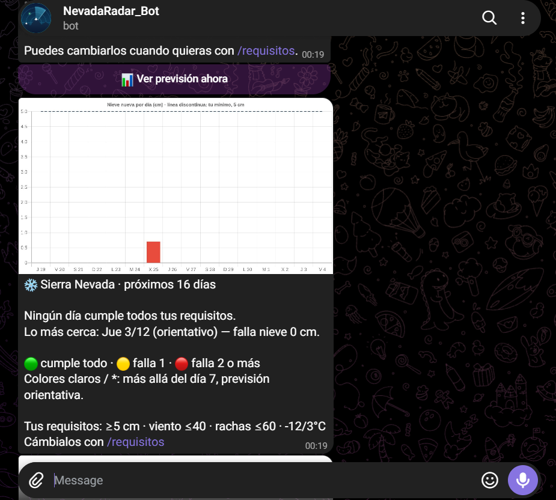
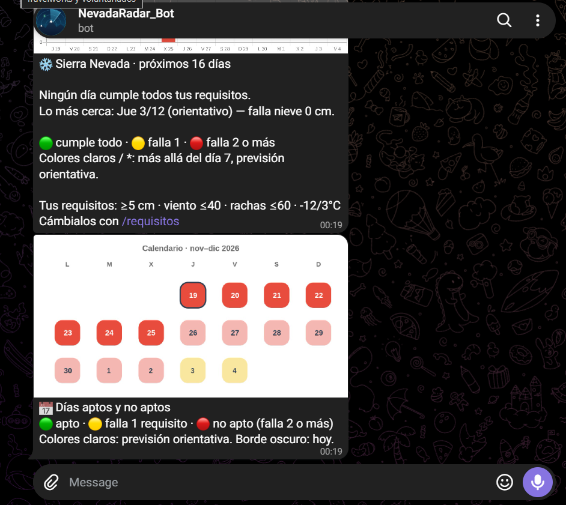
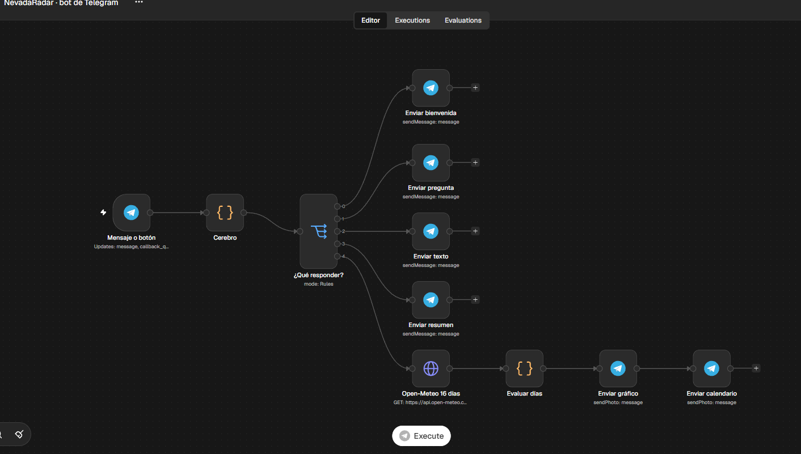
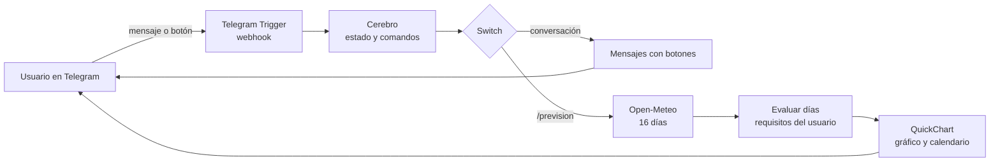

# NevadaRadar ❄️

**Un bot de Telegram que te dice qué días de los próximos 16 merecen la pena para esquiar en Sierra Nevada, según _tus_ requisitos de nieve, viento y temperatura.**

Cada esquiador tiene sus propios límites: unos suben con 5 cm de nieve nueva y otros con 20, unos aguantan rachas de 60 km/h y otros no. NevadaRadar le pregunta a cada usuario los suyos (con botones o escribiendo el valor) y, cuando lo pide con `/prevision`, le contesta con un gráfico de nieve y un calendario de días aptos y no aptos.

## Demo

  

<table>
  <tr>
    <th align="center">1. Configuración con botones</th>
    <th align="center">2. Gráfico de nieve</th>
    <th align="center">3. Calendario</th>
  </tr>
  <tr>
    <td></td>
    <td></td>
    <td></td>
  </tr>
</table>

🟢 cumple todos los requisitos · 🟡 falla 1 · 🔴 falla 2 o más. Más allá del día 7 la previsión es orientativa y se dibuja en colores claros.

> Las capturas son de finales de noviembre, antes de que empiece la temporada: casi no hay nieve prevista, así que el calendario sale en rojo y amarillo. Con nevadas aparecerán días en verde.

El flujo completo en n8n:

## Cómo funciona

1. Telegram avisa a n8n por **webhook** cada vez que alguien escribe o pulsa un botón.
2. El nodo **Cerebro** (JavaScript) identifica al usuario por su chat ID, guarda su estado y sus 5 requisitos, y decide qué responder.
3. Para `/prevision`, se descarga la previsión de 16 días de Open-Meteo y se evalúa **cada día contra los requisitos de ese usuario**.
4. El resultado se dibuja como dos imágenes con QuickChart y se envía al chat.

## Stack y decisiones

- **Open-Meteo**: API abierta y gratuita, sin clave, con nieve, viento, rachas y temperaturas a la altitud de la estación (2.500 m).
- **n8n**: orquesta el flujo de forma visual. Elegí un nodo de Telegram por cada tipo de mensaje porque los botones de ese nodo son fijos; así el flujo se lee de un vistazo y no hace falta guardar el token en el código.
- **La lógica va en scripts testeables** (`src/cerebro.js` y `src/evaluar-dias.js`). Son el cuerpo de los nodos Code de n8n, pero `npm test` los ejecuta fuera de n8n, simulando varios usuarios y datos de previsión, y un script genera el JSON del flujo (`npm run build`). Así la lógica no vive escondida dentro de la interfaz.
- **Estado por usuario en la memoria del flujo** (static data de n8n), indexado por chat ID. Solo se guarda el chat ID, el paso de la conversación y los 5 requisitos; `/borrar` los elimina.
- **QuickChart** para las imágenes: la URL lleva la configuración del gráfico, sin librerías extra ni servidor propio. Solo recibe valores de previsión.
- **Avisos solo bajo demanda**, sin mensajes automáticos diarios: el usuario decide cuándo mirar.

## Qué aprendí y siguientes pasos

Cosas que descubrí construyéndolo:
- Un webhook en local necesita una URL pública: usé un túnel de Cloudflare solo mientras pruebo. La URL cambia en cada reinicio.
- Los botones del nodo Telegram de n8n son estáticos, y el nodo HTTP Request no puede reutilizar su credencial, lo que condicionó el diseño del flujo.
- Dos flujos no pueden compartir el mismo webhook: hay que despublicar el anterior antes de publicar el nuevo.

Estado y siguientes pasos:
- ✅ Versión **n8n en local** funcionando y probada con Telegram real.
- ⏳ Versión **pública 24/7** en Cloudflare Workers (gratis, sin servidor que mantener), reutilizando la misma lógica: pendiente.
- Mejoras posibles: que los botones respondan al pulsarlos, que "tu mejor día" prefiera días fiables a orientativos, un modo demo con datos simulados para presentarlo fuera de temporada y que una IA responda "¿qué día me conviene más?".

## Cómo ejecutarlo

Necesitas Node.js (LTS), n8n y un bot propio de Telegram.

1. Instala n8n: `npm install -g n8n` y arráncalo con `n8n start` (http://localhost:5678).
2. Crea tu bot con **@BotFather** (`/newbot`) y guarda el token. En n8n crea una credencial *Telegram API* con ese token.
3. Los webhooks de Telegram necesitan una URL pública HTTPS. Para probar en local, abre un túnel (por ejemplo `cloudflared tunnel --url http://localhost:5678`) y arranca n8n con la variable `WEBHOOK_URL` apuntando a esa URL.
4. En n8n: Workflows > Import from file > `n8n/nevadaradar-bot.json`. Comprueba que los nodos de Telegram usan tu credencial.
5. Pulsa **Publish** y escribe `/start` a tu bot.

Desarrollo:
- `npm test` prueba la lógica sin abrir n8n.
- `npm run build` regenera `n8n/nevadaradar-bot.json`. Un archivo `.env` opcional con `TELEGRAM_CRED_ID` y `TELEGRAM_CRED_NAME` rellena la credencial en el JSON (está en `.gitignore`).
- Nunca subas tu token de BotFather al repositorio.

## Comandos

| Comando | Qué hace |
|---|---|
| `/start` | Configura tus requisitos (predeterminados o personalizados) |
| `/prevision` | Gráfico de nieve + calendario de días aptos y no aptos |
| `/requisitos` | Cambia tus requisitos |
| `/borrar` | Elimina tus datos |
| `/ayuda` | Explica el bot y los colores |
