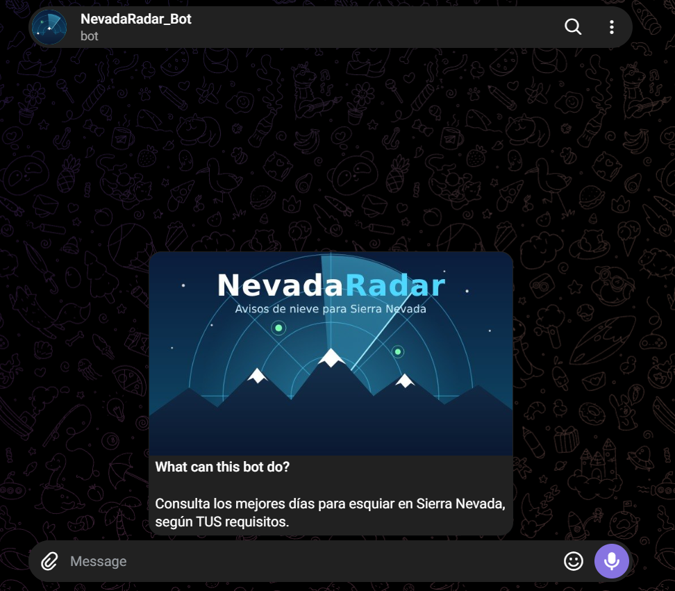
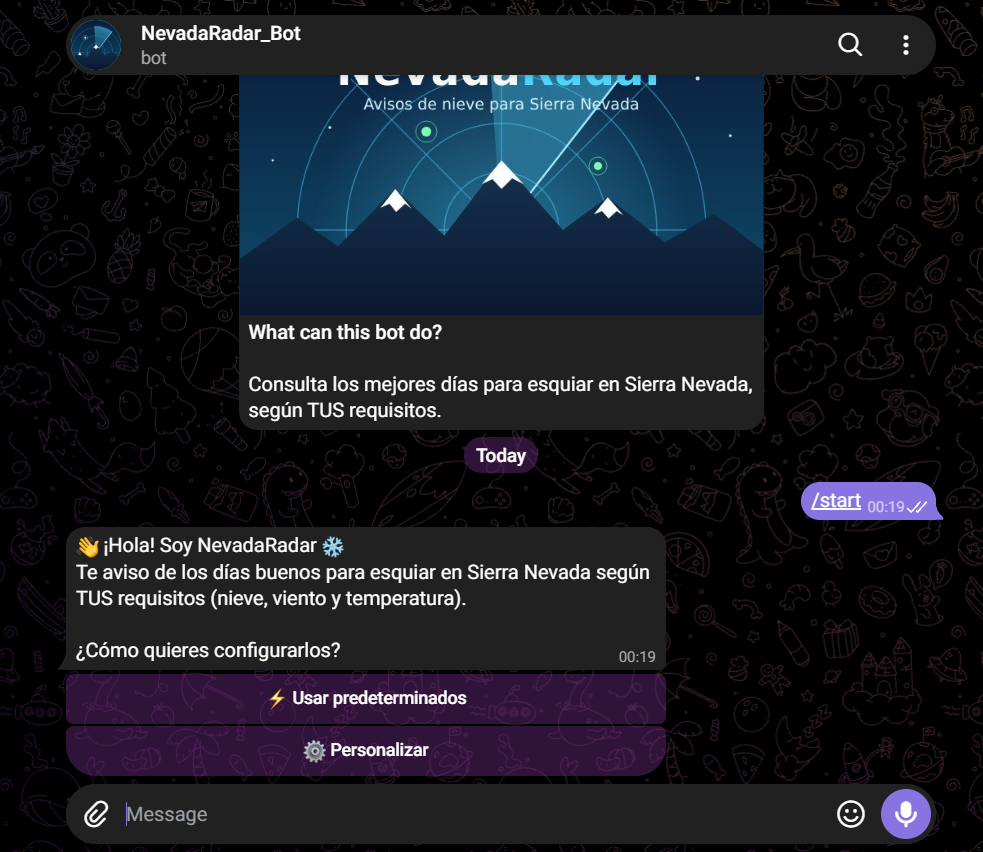
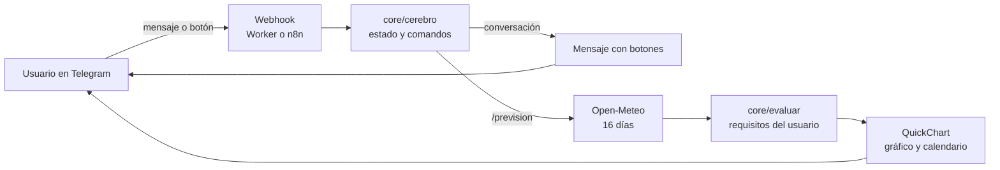

# NevadaRadar ❄️

**Un bot de Telegram que te dice qué días de los próximos 16 merecen la pena para esquiar en Sierra Nevada, según _tus_ requisitos de nieve, viento y temperatura.**

Cada esquiador tiene sus propios límites: unos suben con 5 cm de nieve nueva y otros con 20, unos aguantan rachas de 60 km/h y otros no. NevadaRadar le pregunta a cada usuario los suyos (con botones o escribiendo el valor) y, cuando lo pide con `/prevision`, le contesta con un gráfico de nieve y un calendario de días aptos y no aptos.

👉 **Pruébalo:** [@NevadaRadar_Bot](https://t.me/NevadaRadar_Bot) en Telegram (escribe `/start`).

## Demo

<p align="center">
  
</p>

<table>
  <tr>
    <th align="center">1. Configuración con botones</th>
    <th align="center">2. Gráfico de nieve</th>
    <th align="center">3. Calendario</th>
  </tr>
  <tr>
    <td></td>
    <td></td>
    <td></td>
  </tr>
</table>

🟢 cumple todos los requisitos · 🟡 falla 1 · 🔴 falla 2 o más. Más allá del día 7 la previsión es orientativa y se dibuja en colores claros.

> Las capturas son de finales de noviembre, antes de que empiece la temporada: casi no hay nieve prevista, así que el calendario sale en rojo y amarillo. Con nevadas aparecerán días en verde.

## Dos versiones, una sola lógica

| | **Versión pública** (`cloudflare/`) | **Versión n8n** (`n8n/`) |
|---|---|---|
| Dónde corre | Cloudflare Workers, 24/7, plan gratuito | Tu propio n8n, en local |
| Para qué | Que cualquiera lo use desde Telegram | Ver y modificar el flujo de forma visual |
| Usuarios | Workers KV (una clave por chat) | Memoria del flujo de n8n |
| Botones | Generados desde código; responden al pulsarlos | Un nodo Telegram por mensaje |

Las dos usan los mismos módulos de `core/` (conversación y evaluación), así que se comportan igual y se prueban una sola vez.

## Cómo funciona



1. Telegram avisa por **webhook** cada vez que alguien escribe o pulsa un botón.
2. `core/cerebro.js` identifica al usuario por su chat ID, guarda su estado y sus 5 requisitos, y decide qué responder.
3. Para `/prevision`, se descarga la previsión de 16 días de Open-Meteo y se evalúa **cada día contra los requisitos de ese usuario**.
4. `core/evaluar.js` construye el gráfico y el calendario (como imágenes de QuickChart) y el texto, y se envían al chat.

## Stack y decisiones

- **Open-Meteo**: API abierta y gratuita, sin clave, con nieve, viento, rachas y temperaturas a la altitud de la estación (2.500 m).
- **Lógica en módulos puros y testeables** (`core/`): sin dependencias y sin saber si los ejecuta n8n o un Worker. El build de n8n los incrusta en los nodos Code, y el Worker los importa. `npm test` los comprueba con varios usuarios simulados, en ambas versiones, sin red.
- **Cloudflare Workers + KV** para la versión pública: serverless, gratis, sin servidor que mantener. El webhook solo acepta peticiones con el secreto que se registró en Telegram, y el token del bot vive como secreto del Worker, nunca en el código.
- **n8n** para la versión visual: un nodo Telegram por cada tipo de mensaje, porque los botones de ese nodo son fijos. Así el flujo se lee de un vistazo.
- **QuickChart** para las imágenes: la URL lleva la configuración del gráfico, sin librerías extra ni servidor propio. Solo recibe valores de previsión.
- **Avisos solo bajo demanda**: sin mensajes automáticos; el usuario decide cuándo mirar.
- **Privacidad**: por usuario solo se guarda el chat ID, el paso de la conversación y sus 5 requisitos. `/borrar` los elimina.

## Estructura

```
core/         lógica compartida: cerebro.js (conversación) y evaluar.js (evaluación + imágenes)
cloudflare/   Worker (src/worker.js), wrangler.toml, set-webhook.mjs y sus pruebas
n8n/          flujo importable generado con npm run build
scripts/      build del flujo de n8n y pruebas de core
data/         previsión simulada para las pruebas
docs/img/     capturas del README
```

## Qué aprendí y siguientes pasos

Cosas que descubrí construyéndolo:
- Un webhook en local necesita una URL pública; para probar n8n usé un túnel temporal de Cloudflare, cuya URL cambia en cada reinicio.
- Los botones del nodo Telegram de n8n son estáticos y el nodo HTTP Request no puede reutilizar su credencial, lo que condicionó el diseño del flujo.
- Un bot de Telegram solo puede tener un webhook, y dos flujos de n8n no pueden compartir el mismo: por eso el bot público y el de pruebas con n8n son bots distintos.
- Separar la lógica en `core/` permitió llevarla a un Worker sin reescribirla.

Limitaciones conocidas y mejoras posibles:
- El plan gratuito de Workers KV limita las escrituras diarias, por eso solo se escribe cuando cambia el estado de un usuario. Con mucho tráfico habría que revisarlo.
- Cada `/prevision` consulta Open-Meteo sin caché.
- "Tu mejor día" puede elegir un día orientativo antes que uno fiable.
- Un modo demo con datos simulados para presentarlo fuera de temporada, y una IA que responda "¿qué día me conviene más?".

## Cómo ejecutarlo

Necesitas Node.js (LTS). Antes de nada, crea tu propio bot con **@BotFather** (`/newbot`) y guarda el token.

### A) Tu propio Worker de Cloudflare (24/7)
1. `cd cloudflare && npm install`, e inicia sesión con `npx wrangler login`.
2. `npx wrangler deploy`: crea el almacén KV `USERS` y te da una URL `https://nevadaradar.<tu-subdominio>.workers.dev`.
3. Genera un secreto (`node -e "console.log(require('crypto').randomBytes(24).toString('hex'))"`) y guarda los dos secretos:
   `npx wrangler secret put WEBHOOK_SECRET` y `npx wrangler secret put TELEGRAM_BOT_TOKEN`.
4. Registra el webhook con el token y el secreto en variables de entorno:
   `node set-webhook.mjs https://nevadaradar.<tu-subdominio>.workers.dev`.
5. Escribe `/start` a tu bot.

En Windows PowerShell, si `npx` da un error de "running scripts is disabled", usa `npx.cmd`.

### B) n8n en local
1. Instala n8n (`npm install -g n8n`) y arráncalo con `n8n start` (http://localhost:5678). En n8n crea una credencial *Telegram API* con tu token.
2. Los webhooks de Telegram necesitan una URL pública HTTPS. Para probar en local, abre un túnel (por ejemplo `cloudflared tunnel --url http://localhost:5678`) y arranca n8n con la variable `WEBHOOK_URL` apuntando a esa URL.
3. En n8n: Workflows > Import from file > `n8n/nevadaradar-bot.json`. Comprueba que los nodos de Telegram usan tu credencial.
4. Pulsa **Publish** y escribe `/start` a tu bot. Si ya había otro flujo publicado con el mismo webhook, despublícalo antes.

### Desarrollo
- `npm test` prueba la lógica de n8n y del Worker sin abrir nada.
- `npm run build` regenera `n8n/nevadaradar-bot.json` a partir de `core/`. Un archivo `.env` opcional con `TELEGRAM_CRED_ID` y `TELEGRAM_CRED_NAME` rellena la credencial en el JSON (está en `.gitignore`).
- Nunca subas tu token de BotFather al repositorio.

## Comandos

| Comando | Qué hace |
|---|---|
| `/start` | Configura tus requisitos (predeterminados o personalizados) |
| `/prevision` | Gráfico de nieve + calendario de días aptos y no aptos |
| `/requisitos` | Cambia tus requisitos |
| `/borrar` | Elimina tus datos |
| `/ayuda` | Explica el bot y los colores |
